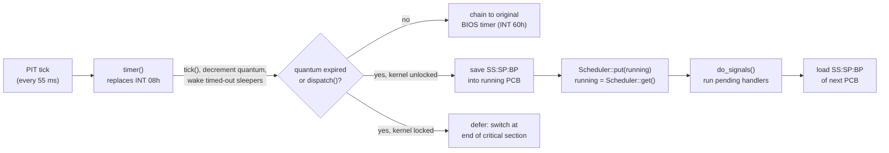

# Mini preemptive multithreading kernel (x86 real mode)

A small operating system kernel that adds **preemptive, time-sliced multithreading** to a DOS program. It is written in C++ with inline x86 assembly for Borland C++ 3.1 and runs in 16-bit real mode.

It was built for the *Operating Systems 1* course at the School of Electrical Engineering, University of Belgrade (2020). The course provided the scheduler (`Scheduler/`) and the public test program (`APPLICAT.LIB`). Everything in `h/` and `src/` is my implementation.

## Features

| Feature | Public API | Implementation |
| --- | --- | --- |
| Threads with their own stacks and time slices | `Thread` (`start`, `waitToComplete`, `getId`, `getThreadById`) | `PCB` |
| Preemptive round-robin scheduling | `dispatch()` for a voluntary yield | timer ISR on `INT 08h` |
| Counting semaphores with optional timeout | `Semaphore` (`wait(maxTime)`, `signal(n)`, `val`) | `KernelSem` + delta list |
| Events bound to hardware interrupts | `Event`, `PREPAREENTRY(ivtNo, callOld)` | `KernelEv`, `IVTEn` |
| POSIX-style signals | `Thread::signal`, `registerHandler`, `blockSignal[Globally]`, `swap` | `Signals`, `Handlers` |

## How it works



- **Context switch.** `inic()` patches the interrupt vector table so the timer interrupt (`INT 08h`) points to `timer()` and moves the original BIOS handler to `INT 60h`. On a switch, the ISR saves `SS`, `SP` and `BP` into the running thread's PCB, asks the scheduler for the next thread, and loads that thread's stack. Returning from the ISR with `iret` then resumes the new thread.
- **New thread stacks** are pre-built to look like an interrupted context: the flags word with the interrupt flag set (`0x200`), followed by `CS:IP` of `PCB::wrapper`. The first switch to a thread therefore "returns" into its `run()` method.
- **Critical sections** use a lock flag rather than `cli`/`sti`. If the timer fires while the kernel is locked, the switch is postponed (`dispatch_lockFlag`) and performed as soon as the critical section ends. Interrupts stay enabled for the rest of the system.
- **Idle thread.** When the ready queue is empty, an idle thread spins so that the timer ISR always has something to switch to.
- **Timed semaphore waits** use a **delta list**: sleeping threads are kept sorted, and each one stores its wait time relative to its predecessor. Each tick therefore only decrements the head of the list (O(1)).
- **Thread completion.** When `run()` returns, the wrapper unblocks every thread in `waitToComplete()`, sends signal 1 to the parent and signal 2 to the thread itself, then marks the thread finished and yields.
- **Signals** are queued per thread and delivered when the thread is next scheduled. Signal 0 terminates the thread. Signals can be blocked per thread or globally.

## Project layout

```
h/            kernel headers (public API: thread.h, semaphor.h, event.h)
src/          kernel implementation
Scheduler/    course-provided scheduler and test application (binary)
docs/         original assignment specification (Serbian)
```

## Building

The kernel targets **Borland C++ 3.1** (16-bit DOS, large memory model). On a modern machine, use DOSBox:

1. Install Borland C++ 3.1 inside DOSBox and mount this repository as a drive.
2. Create a project that contains every file in `src/` plus `Scheduler/APPLICAT.LIB`, with `h/` and `Scheduler/` on the include path.
3. Select the **large** memory model, then build and run. `APPLICAT.LIB` provides `userMain()`, which runs the course's public test suite.

## Notes

The original code was written against the course deadline. Two kernel bugs were fixed later:
- `Thread::unregisterAllHandlers` skipped nodes and could dereference null after deleting a handler.
- The delta-list tick read `time_wait` before checking whether the list had emptied.
